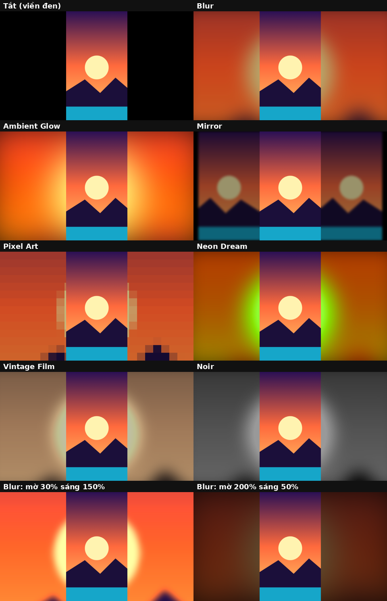
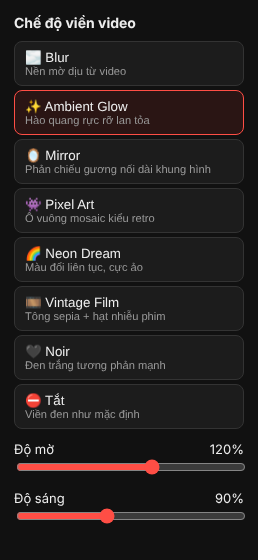
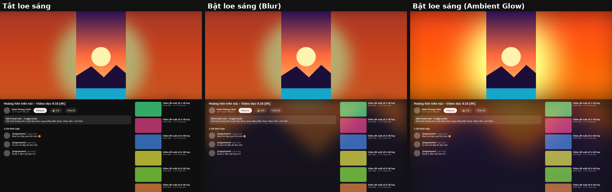

# YouTube Blur Fill

Extension Chrome/Edge thay viền đen quanh video YouTube (khi tỉ lệ video không khớp màn hình, ví dụ video dọc, 4:3, 21:9...) bằng nền mờ lấy từ chính nội dung video.

## Cài đặt
1. Mở `chrome://extensions` (hoặc `edge://extensions`).
2. Bật **Developer mode**.
3. Bấm **Load unpacked** → chọn thư mục `youtube-ambient-blur`.
4. Mở/tải lại trang YouTube.

## Preview

## Chế độ
Bấm icon extension trên thanh công cụ để chọn:
- 🌫️ **Blur** – nền mờ dịu (mặc định)
- ✨ **Ambient Glow** – hào quang rực rỡ
- 🪞 **Mirror** – phản chiếu gương nối dài khung hình
- 👾 **Pixel Art** – mosaic retro
- 🌈 **Neon Dream** – màu xoay vòng liên tục
- 🎞️ **Vintage Film** – sepia + hạt nhiễu phim
- 🖤 **Noir** – đen trắng tương phản cao
- ⛔ **Tắt**

## Thanh trượt
Trong popup có 2 thanh trượt **Độ mờ** (0–200%) và **Độ sáng** (20–200%), áp dụng ngay cho mọi chế độ.

## Chế độ rạp (theater)
Khi bật chế độ rạp (phím `t`), ánh sáng từ video loe xuống phần tiêu đề, mô tả, bình luận và video đề xuất rồi mờ dần. Bật/tắt bằng ô "Loe sáng xuống dưới" trong popup. Hiệu ứng dùng `mix-blend-mode: screen` nên rõ nhất ở giao diện tối (dark theme); chữ vẫn giữ nguyên độ đọc.

## Tuỳ chỉnh
- Độ mờ / độ sáng: sửa `filter` trong `style.css`.
- Tốc độ cập nhật: sửa `FPS` trong `content.js` (thấp hơn = nhẹ máy hơn).
